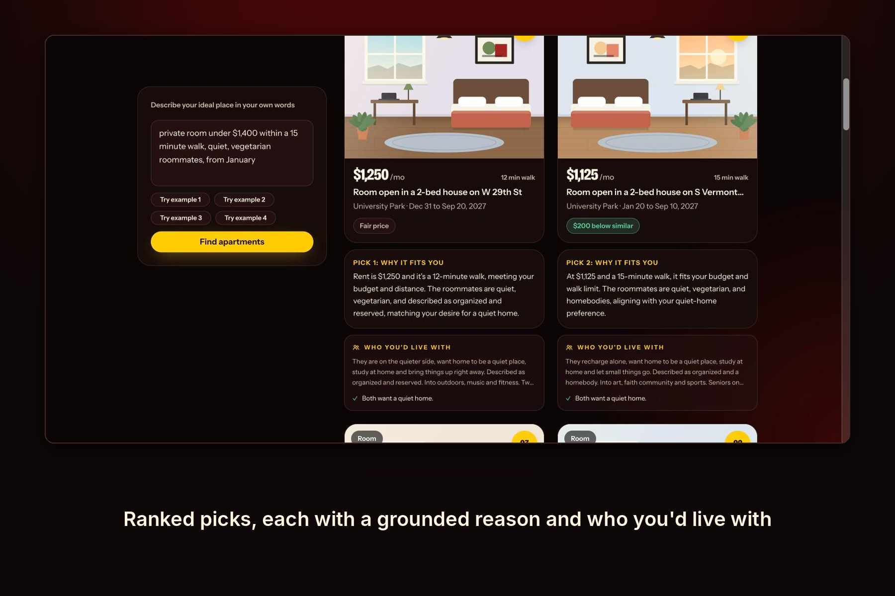

# HOMIE

**Find your place. Find your people.**

**Live:** https://homie-silk.vercel.app · **Demo video:** see the Devpost page · **Deck:** https://docs.google.com/presentation/d/1BZBlKmTDsgUBp7-wq4ZM9w9_LbCWebHi4gAvqRN_Iug/edit



HOMIE is an AI-powered student housing network, starting with USC. It connects students who are subleasing, taking over leases, looking for rooms or replacing roommates, and it gives every apartment building an honest, evidence-backed profile built from resident reviews.

| Module | What it does |
| --- | --- |
| **AI housing & roommate matching** | Scores a seeker against a listing on rent, dates, location, lifestyle and (soon) semantic profile similarity. Every score comes with the reasons behind it. |
| **AI apartment intelligence** | Extracts structured findings from free-text reviews, flags recurring problems and answers questions, always reporting sample size, verified-resident count and reporting period. |

## Stack

- **Frontend:** Next.js 16 (App Router), React 19, TypeScript, Tailwind CSS v4, Motion, three.js, Leaflet
- **Backend:** Python 3.11+, FastAPI, Pydantic v2, pydantic-settings
- **Database:** PostgreSQL 16, SQLAlchemy 2, pgvector
- **AI:** provider-agnostic LLM and embedding layers (offline mock/hashing providers by default, any OpenAI-compatible API when configured)

## Repository layout

```
homie/
├── frontend/                 Next.js web app (USC cardinal and gold theme)
├── backend/
│   ├── app/
│   │   ├── api/              HTTP routes (thin: validate, call service, return)
│   │   ├── core/             settings, error types and handlers
│   │   ├── database/         engine, sessions, schema init
│   │   ├── models/           SQLAlchemy tables (with pgvector columns)
│   │   ├── schemas/          Pydantic request/response models
│   │   ├── services/
│   │   │   ├── matching/                 compatibility scoring and ranking
│   │   │   ├── apartment_intelligence/   review extraction and aggregation
│   │   │   ├── embeddings/               embedding provider interface + impls
│   │   │   └── llm/                      LLM provider interface + impls
│   │   └── main.py           app factory
│   ├── tests/
│   └── requirements.txt
├── docs/                     architecture, API, AI design, database schema
├── .github/workflows/ci.yml  lint, tests, schema check, frontend build
├── docker-compose.yml        Postgres + pgvector for local dev
└── .env.example
```

## Quick start

Prerequisites: Python 3.11+, Node 20+, and Docker (or any Postgres 16 with pgvector).

```bash
git clone https://github.com/sauravcodes-dotcom/homie.git
cd homie
cp .env.example .env            # defaults work offline, no API keys needed
```

**1. Database**

```bash
docker compose up -d db
```

**2. Backend** (http://localhost:8000, interactive docs at `/docs`)

```bash
cd backend
python -m venv .venv && source .venv/bin/activate
pip install -r requirements-dev.txt
python -m app.database.init_db   # creates the vector extension and tables
uvicorn app.main:app --reload
```

**3. Frontend** (http://localhost:3000, needs Node 22 or newer)

```bash
cd frontend
npm install
npm run dev
```

The Next.js dev server forwards `/api` to the backend, so there is no CORS setup.

**No Docker?** Run the backend on SQLite instead, and optionally load fictional sample data:

```bash
cd backend
export DATABASE_URL=sqlite:///./homie-dev.db
python -m app.database.sample_data     # optional: sample buildings, listings and reviews
uvicorn app.main:app --reload
```

## What is in the app

| Area | What it does |
| --- | --- |
| Sign-in | 6-digit code sent to a `@usc.edu` address. Without an email key the code is shown on screen (demo mode). |
| Lifestyle quiz | Budget, dates, neighborhoods, sleep, cleanliness, smoking, drinking, diet, pets, bio. |
| Discover | Swipe deck of ranked listings and (opt-in) roommates. Right saves, left passes. |
| Listings | Post, browse and filter. Photos, map pin, AI listing writer, red-flag check, fair-price badge on every listing (rent vs the median of the same kind and size of space, at the same walking distance and timing). |
| Roommate notes | The student subleasing a room describes the roommates on the listing. |
| Messages | In-app conversations with listers and saved roommates. |
| Person reviews | Rate someone as a roommate, subletter or lister once you have both messaged each other. |
| Buildings | Resident reviews, recurring-problem detection, ask-a-building with cited quotes, verified-resident badge. |
| Public-review fallback | Buildings with fewer than 5 HOMIE reviews show a labelled summary of a random sample of public Google reviews (needs `EXTERNAL_REVIEWS_PROVIDER`). |
| Map | Listings with estimated walk and bike time to campus. |

## Checks

```bash
cd backend && ruff check . && ruff format --check . && pytest
cd frontend && npm run lint && npm run build
```

CI runs the same steps on every push and pull request, plus schema creation against a real Postgres + pgvector service.

## API at a glance

| Method | Path | Purpose |
| --- | --- | --- |
| GET | `/api/health` | Liveness, DB status, active AI providers |
| POST | `/api/matching/score` | Explainable score for one seeker and one listing |
| POST | `/api/matching/rank` | Rank many listings for a seeker |
| POST | `/api/apartment-intelligence/extract` | Structured extraction from one review (LLM) |
| POST | `/api/apartment-intelligence/insights` | Aggregate extracted reviews into grounded insights |

Details in [docs/API.md](docs/API.md).

## Documentation

- [Architecture](docs/ARCHITECTURE.md)
- [API](docs/API.md)
- [AI design](docs/AI_DESIGN.md)
- [Database schema](docs/DATABASE_SCHEMA.md)

## Security

Secrets are read from environment variables only. `.env` files are git-ignored; commit changes to `.env.example` instead. Never put real keys in code, tests or docs.
